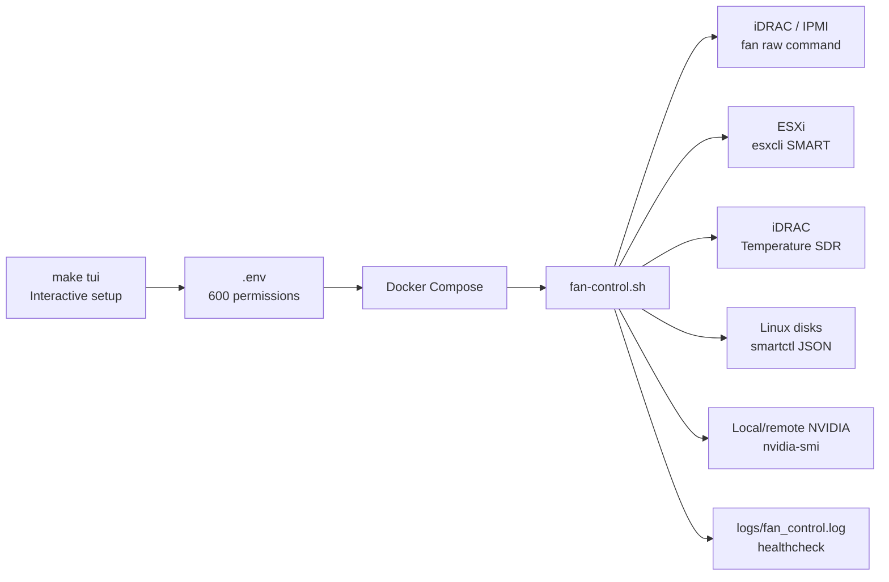
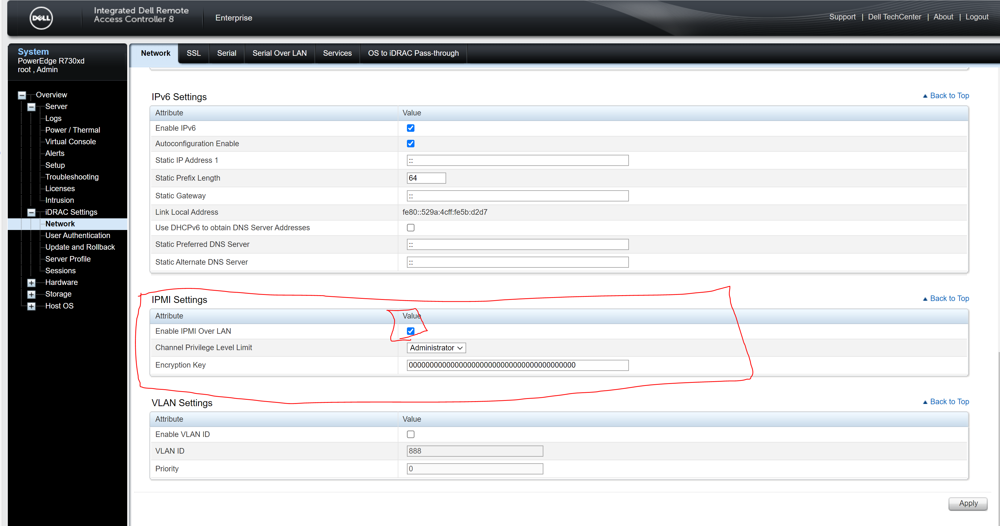
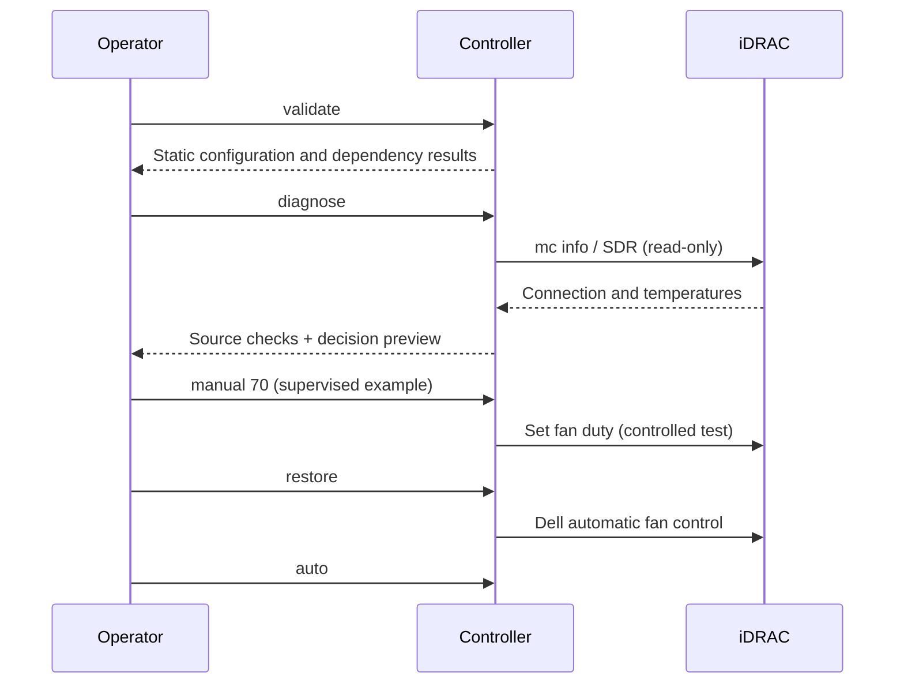
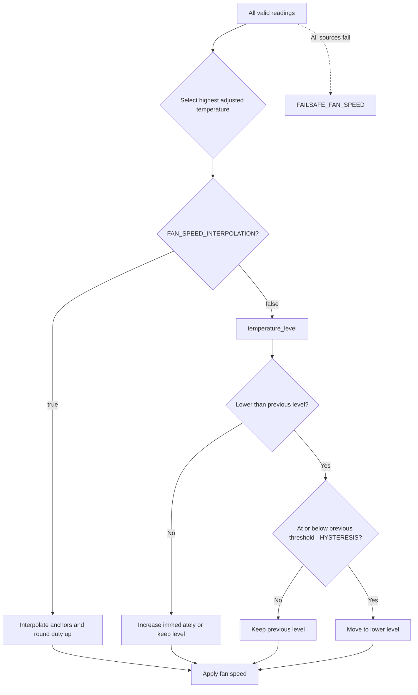

# iDRAC Fan Speed Control

**English** | [繁體中文](README.zh-TW.md)

[](#testing-and-quality-gates)
[](https://github.com/DF-wu/iDRACFanSpeedControl/pkgs/container/idrac-fan-control)
[](LICENSE)

A fan controller for Dell PowerEdge servers. It sets the fan duty cycle through iDRAC IPMI OEM raw commands, then calculates fan speed from a configurable curve using pluggable temperature sources: ESXi NVMe SMART, iDRAC sensors, local Linux disks, and local or remote NVIDIA GPUs.

> [!CAUTION]
> This project has been tested on only my Dell PowerEdge R730xd with iDRAC 8. Other server models and iDRAC firmware versions are untested and must not be assumed compatible. This program temporarily overrides Dell's automatic fan control; use it at your own risk. During initial setup, keep the iDRAC Web UI or a physical console available. Verify `manual`, `restore`, and `diagnose` on your own hardware before running `auto` for an extended period. If the server overheats, readings become unreliable, or behavior is abnormal, stop the controller and explicitly run `restore`; confirm recovery in iDRAC. See the [recovery procedure](USAGE_GUIDE.md#stop-and-restore-dell-automatic-control).

## How it works



The controller sends fan commands only to iDRAC; all temperature sources are read-only. Every provider implements the same `validate`, `collect`, and `adjust` interface. When multiple sources are enabled, the controller uses the highest valid adjusted temperature. Raw readings outside −20…150°C are rejected before offsets. Failed sources/targets are logged; remaining valid readings still drive control, so a partial failure can remove the hottest component from the decision. GPU and disk offsets let unlike sensors share one fan curve without source-specific decision code.



*Figure 1: Enabling IPMI over LAN in the iDRAC Web UI. The exact option name may vary by iDRAC firmware version.*

## Prerequisites and compatibility

- A Linux Docker host with Git, Bash 4+, Make, Docker Engine, and Docker Compose with `env_file` support. GPU deployments additionally need Compose support for `gpus: all`, the NVIDIA driver, and NVIDIA Container Toolkit.
- Access to the iDRAC management network, IPMI over LAN enabled, and an account permitted to use the OEM fan commands. Keep an iDRAC Web UI session or physical console available.
- Historical hardware testing covers **one PowerEdge R730xd with iDRAC 8**. There is no verified firmware compatibility matrix; R730, other generations, and other firmware revisions require their own checks. Successful IPMI login does not prove fan-command support. No new hardware verification is claimed by this documentation update.
- Optional sources need ESXi SSH with readable NVMe SMART data, mapped local Linux disks, local NVIDIA GPUs, or SSH access to remote NVIDIA hosts. Start with `idrac` only, then add sources individually. An inlet sensor alone may not reflect hot disks or GPUs; choose sensors and a conservative curve for your hardware.

Check the host tools before proceeding:

```bash
git --version
bash --version
make --version
docker version
docker compose version
```

## Quick start: safe first-time setup with the TUI

Run the setup on the Docker host. The TUI requires no `dialog`, Python, or other additional packages. It is written in pure Bash, preserves comments from `.env.example`, updates files atomically, and sets file permissions to `600`.

```bash
git clone https://github.com/DF-wu/iDRACFanSpeedControl.git
cd iDRACFanSpeedControl
make tui
```

The main menu looks like this. Each submenu writes changes back to `.env`, and the file location is shown again when you exit.

```text
  1) Quick setup wizard
  2) iDRAC / IPMI settings
  3) Temperature source preset
  4) ESXi NVMe source settings
  5) Local Linux disk settings
  6) Remote NVIDIA GPU settings
  7) Fan curve
  8) Safety, timing, and logging
  9) Review redacted configuration
 10) Validate configuration
 11) Run read-only diagnostics
  0) Save and exit
```

For your first setup, select `iDRAC sensors only` and leave external sources disabled. Set `OPERATION_MODE=auto`, keep `RESTORE_AUTO_ON_EXIT=true`, replace all selected-source placeholders, and review the curve before starting. The TUI saves configuration; it does not start the service. After completing the TUI, run:

```bash
mkdir -p logs secrets
docker compose pull
make validate
docker compose run --rm --no-deps idrac-fan-control config
docker compose run --rm --no-deps idrac-fan-control diagnose
```

`diagnose` never sends fan raw commands. It reads hardware and remote hosts and creates/touches the local log path. It checks iDRAC, every temperature source, the writable log path, and previews the fan level that would be selected. If you do not need a source, remove it from the TUI source preset instead of ignoring its errors.

Before starting unattended control, complete the supervised [manual and restore checks](#safe-startup-sequence). Only then start the service:

```bash
docker compose up -d
docker compose ps
docker logs -f idrac-fan-control
```

Use the repository-root `.env` for Compose. The TUI's `--config /path/to/staging.env` option edits an alternate file, but Compose still requires the repository `.env`; copy the reviewed configuration there before deployment. Do not use alternate-file diagnostics as proof of the deployed configuration.

### Create `.env` manually

```bash
cp .env.example .env
chmod 600 .env
$EDITOR .env
```

Minimal iDRAC-only example:

```dotenv
IDRAC_IP=192.0.2.10
IDRAC_ID=root
IDRAC_PASSWORD=change-me
OPERATION_MODE=auto
TEMPERATURE_SOURCES=idrac
```

Replace `IDRAC_PASSWORD`, the IP address, and the management network with real values. Values such as `192.0.2.*`, `change-me`, and `replace_with_*` in `.env.example` are intentional placeholders and will be rejected by `validate`.

## Command reference

| Command | Purpose | Changes fan control |
| --- | --- | --- |
| `auto` | Continuously controls fans from the configured curve and restores automatic mode on exit when configured | Yes |
| `once` | Reads temperatures once, applies one decision, and exits | Yes |
| `manual 35` | Sets a 35% duty cycle; without a number, uses `MANUAL_FAN_SPEED` | Yes |
| `restore` | Sends the Dell automatic fan-control command | Yes (restore) |
| `status` | Shows chassis status and raw temperature SDR data | No |
| `config` | Shows the effective configuration; passwords are shown only as set/length | No |
| `validate` | Checks values, placeholders, required commands, and source conditions | No |
| `diagnose` | Probes connections and temperature readings and shows a decision preview | No |
| `healthcheck` | Checks configuration and whether the auto-control log was updated recently enough | No |

With Docker Compose:

```bash
docker compose run --rm idrac-fan-control config
docker compose run --rm idrac-fan-control validate
docker compose run --rm idrac-fan-control diagnose
docker compose run --rm idrac-fan-control status
docker compose run --rm idrac-fan-control once
docker compose run --rm idrac-fan-control manual 35
docker compose run --rm idrac-fan-control restore
```

`manual` and `once` leave their selected duty active after exiting; run `restore` explicitly. `RESTORE_AUTO_ON_EXIT` applies only to continuous `auto`. Stop any active controller before one-off fan commands so the next cycle cannot overwrite them. The Compose service uses `restart: unless-stopped`; keep its `.env` mode at `auto`, and invoke `manual`/`once` only as one-off `docker compose run --rm --no-deps` commands.

The local script accepts the same commands but **does not load `.env`**. It reads exported environment variables; prefer Compose for the configured deployment. A safe offline local check is:

```bash
make validate-example
src/FanControlWithEsxiSmart.sh help
```

Local execution requires Bash 4+, GNU coreutils (`timeout`, `stat`), awk, and `ipmitool`. Linux disk mode also requires `smartctl` and `jq`; SSH sources require OpenSSH, and password authentication requires `sshpass`. Local GPU mode requires `nvidia-smi`. The Docker image includes the CLI dependencies other than the host NVIDIA driver/toolkit.

## Safe startup sequence



Before unattended operation, confirm each item:

1. IPMI over LAN is enabled in the iDRAC Web UI and the management network is reachable.
2. The iDRAC account has the required permissions and its password is not a placeholder.
3. With the controller stopped, test a conservative duty (for example `manual 70`) while watching temperatures and fans in iDRAC, then run `restore` and verify Dell automatic control. Adjust the duty only within a supervised maintenance window; no percentage is universally safe.
4. Every enabled source reports `[PASS]` in `diagnose`; disable sources you do not use.
5. Start with a conservative `FAILSAFE_FAN_SPEED` and `RESTORE_AUTO_ON_EXIT=true`.

Example supervised checks (these **change hardware**; run only on your own compatible server):

```bash
docker compose stop --timeout 90
docker compose run --rm --no-deps idrac-fan-control manual 70
docker compose run --rm --no-deps idrac-fan-control status
docker compose run --rm --no-deps idrac-fan-control restore
```

`auto` is this project's software loop; it repeatedly takes manual control of iDRAC. `restore` returns control to Dell's firmware algorithm. Exit restoration is best-effort: foreground queries/sleep can delay signal handling, Docker can force-kill the process, and a host/network failure can prevent IPMI restoration. Always use the explicit [stop and restore procedure](USAGE_GUIDE.md#stop-and-restore-dell-automatic-control).

## Temperature sources and control decisions

`TEMPERATURE_SOURCES` is a comma-separated list containing `esxi`, `idrac`, `gpu`, `linux_disk`, and/or `remote_gpu`. Sources can be combined, and the controller retains each source label for logging and diagnostics. See [Temperature source interface](docs/TEMPERATURE_SOURCES.md) for the extension contract and deployment examples.

| Source | Reading | Requirements | Behavior on failure |
| --- | --- | --- | --- |
| `idrac` | Readable sensors from `ipmitool sdr type Temperature` | iDRAC IPMI | Marks this source as failed |
| `esxi` | `esxcli storage core device smart get` for the configured NVMe device | SSH and `DRIVE_DEVICE` | Marks this source as failed |
| `gpu` | Temperature of each local GPU reported by `nvidia-smi` | NVIDIA Container Toolkit and driver | Marks this source as failed |
| `linux_disk` | SMART temperature for each configured Linux device | `smartctl`, `jq`, and device access | Fails unreadable devices; keeps other valid disks |
| `remote_gpu` | Every GPU reported by `nvidia-smi` on each configured VM | SSH credentials and remote NVIDIA driver | Fails unreachable hosts; keeps other valid VMs |



The default interpolation anchors and boundary speeds are shown below. Between anchors, duty rises linearly; the logged level names still describe the temperature band. `validate` ensures that thresholds are strictly increasing, fan speeds never decrease, and the fail-safe speed is not lower than the critical speed.

| Level | Anchor / boundary temperature | Default fan speed |
| --- | --- | --- |
| `idle` | `<65°C` | 30% |
| `low` | `65°C` | 30% |
| `medium` | `70°C` | 40% |
| `high` | `75°C` | 50% |
| `critical` | `>=80°C` | 60% |
| `failsafe` | All sources fail | 70% |

`FAN_SPEED_INTERPOLATION=true` is the default, including for existing configurations that omit the option. It joins `(TEMP_LOW, FAN_SPEED_LOW)`, `(TEMP_MEDIUM, FAN_SPEED_MEDIUM)`, `(TEMP_HIGH, FAN_SPEED_HIGH)`, and `(TEMP_CRITICAL, FAN_SPEED_CRITICAL)` with straight segments. Duty is rounded **up** to an integer percentage, stays monotonic within the validated 1–100% range, uses `FAN_SPEED_IDLE` below `TEMP_LOW`, and clamps to `FAN_SPEED_CRITICAL` at or above `TEMP_CRITICAL`. There is no invented idle-temperature anchor: distinct idle and low speeds intentionally cause a jump at `TEMP_LOW`.

Interpolation ignores `HYSTERESIS` and the previous level in both directions. Each successful collection cycle uses the current demand immediately, including increases within the same level; unchanged integer duty does not send another fan command. There is no additional smoothing, PID, or rate limit. For example, thresholds `65/70/75/80` and speeds `30/35/45/60/65` produce `45/48/51/54/57/60%` at `70/71/72/73/74/75°C`.

Set `FAN_SPEED_INTERPOLATION=false` to restore the original stepwise behavior: each anchor speed is held until the next threshold, and only downshifts wait for the temperature to reach the previous level threshold minus `HYSTERESIS` (equality releases the hold). Upshifts are immediate. In the TUI, change this switch under **Fan curve**; `config` and read-only `diagnose` show the mode and whether hysteresis is active.

Each source owns its adjustment: local and remote GPUs subtract their configured offset, Linux disks subtract `LINUX_DISK_TEMP_OFFSET`, and all results have a minimum of 0°C.

## Configuration reference

### Connection and operating mode

| Variable | Default | Description |
| --- | --- | --- |
| `IDRAC_IP` | Empty | iDRAC hostname or IP; required for all fan commands |
| `IDRAC_ID` | `root` | iDRAC user |
| `IDRAC_PASSWORD` | Empty | Passed to `ipmitool -E` through the `IPMI_PASSWORD` environment variable; never appears in argv |
| `IPMI_INTERFACE` | `lanplus` | Usually left unchanged |
| `IPMI_TIMEOUT` / `IPMI_RETRIES` | `5` / `2` | Per-command timeout and retry count |
| `OPERATION_MODE` | `manual` (template: `auto`) | Command used when no CLI command is supplied |
| `DRY_RUN` | `false` | Suppresses IPMI calls only; SSH, GPU, and disk collectors can still run. Not an offline sandbox |
| `COMMAND_TIMEOUT` | `20` | Maximum duration in seconds for SSH, IPMI, and GPU commands |
| `CHECK_INTERVAL` | `60` | Seconds between cycles in auto mode |
| `RESTORE_AUTO_ON_EXIT` | `true` | Best-effort restore on continuous `auto` exit; not a guarantee after SIGKILL, power loss, or network failure |

### Temperature sources

| Variable | Default | Description |
| --- | --- | --- |
| `TEMPERATURE_SOURCES` | `esxi` | Comma-separated list of registered source IDs |
| `WITH_GPU_TEMP` | `false` | Legacy compatibility switch; `true` appends `gpu` |
| `GPU_TEMP_OFFSET` | `15` | Offset subtracted from GPU temperature |
| `ESXI_HOST` / `ESXI_USERNAME` | Empty / `root` | ESXi SSH target |
| `ESXI_PASSWORD` | Empty | Used when no key is configured; never echoed by the TUI |
| `ESXI_SSH_KEY` | Empty | Preferred over password authentication when set |
| `ESXI_SSH_PORT` | `22` | SSH port (1–65535) |
| `SSH_CONNECT_TIMEOUT` | `10` | SSH connection timeout in seconds |
| `SSH_STRICT_HOST_KEY_CHECKING` | `accept-new` | `yes`, `no`, `ask`, or `accept-new` |
| `DRIVE_DEVICE` | Empty | Full ID returned by `esxcli storage core device list` |
| `LINUX_DISK_DEVICES` | Empty | Comma-separated Linux device paths, such as `/dev/nvme1,/dev/sdb` |
| `LINUX_DISK_TEMP_OFFSET` | `0` | Offset subtracted from local disk temperatures |
| `LINUX_DISK_NOCHECK` | `never` | smartctl power-mode check; `standby` avoids waking sleeping disks |
| `REMOTE_GPU_HOSTS` | Empty | Comma-separated Linux VM hostnames or addresses |
| `REMOTE_GPU_USERNAME` / `REMOTE_GPU_SSH_PORT` | `root` / `22` | SSH identity shared by remote GPU hosts |
| `REMOTE_GPU_PASSWORD` / `REMOTE_GPU_SSH_KEY` | Empty / Empty | Remote GPU SSH authentication; keys are preferred |
| `REMOTE_GPU_TEMP_OFFSET` | `15` | Offset subtracted from remote GPU temperatures |
| `IDRAC_SENSOR_INCLUDE_REGEX` | Empty | awk regex used to keep matching sensor names only |
| `IDRAC_SENSOR_EXCLUDE_REGEX` | `no reading\|disabled\|not readable` | Excludes invalid SDR entries |

### Fan curve, safety, and diagnostics

| Variable | Default | Description |
| --- | --- | --- |
| `TEMP_LOW/MEDIUM/HIGH/CRITICAL` | `65/70/75/80` | Strictly increasing thresholds in °C |
| `FAN_SPEED_IDLE/LOW/MEDIUM/HIGH/CRITICAL` | `30/30/40/50/60` | Values from 1–100% that must not decrease; unset idle follows low |
| `FAN_SPEED_INTERPOLATION` | `true` | Piecewise linear interpolation with ceiling rounding; `false` restores legacy steps |
| `HYSTERESIS` | `2` | Stepwise mode only: degrees below the previous threshold required before lowering fan speed |
| `FAILSAFE_ON_ERROR` | `true` | Uses a conservative speed when all sources fail |
| `FAILSAFE_FAN_SPEED` | `70` | Must be greater than or equal to the critical speed |
| `MANUAL_FAN_SPEED` | Empty (template: `35`) | Used without a speed argument; otherwise prompts on a terminal or fails on noninteractive stdin |
| `LOG_DIR` / `LOG_FILE` | `/var/log/fan-control` / `fan_control.log` | Persistent state log |
| `LOG_LEVEL` | `INFO` | `DEBUG` adds command and source details but never logs passwords |
| `HEALTHCHECK_MAX_AGE` | `0` | `0` means `CHECK_INTERVAL*3 + COMMAND_TIMEOUT` |

## Docker deployment, Linux disks, and GPUs

The Compose configuration uses `ghcr.io/df-wu/idrac-fan-control:latest`, Linux host networking, and a `./logs` volume by default. `latest` tracks default-branch builds and is not a stable release pin. Record a known-good digest before upgrading; see [upgrade and rollback](USAGE_GUIDE.md#upgrade-and-rollback).

```bash
docker compose pull
docker compose up -d
docker compose ps
docker inspect --format '{{.State.Health.Status}}' idrac-fan-control
```

The `healthcheck` verifies more than environment configuration. In `OPERATION_MODE=auto`, it also confirms that `fan_control.log` has been updated within `HEALTHCHECK_MAX_AGE`. If every data source fails while `FAILSAFE_ON_ERROR=false`, the control cycle does not write a success record and the container becomes unhealthy. This is an intentional safety signal. Fail-safe records also keep the log fresh: `healthy` does not mean every sensor works or the hardware is cool. Docker does not restart a container just because it is unhealthy. Check logs and iDRAC independently.

GPU mode requires the NVIDIA Container Toolkit. Uncomment `gpus: all` in `docker-compose.yml`, then configure:

```dotenv
TEMPERATURE_SOURCES=idrac,gpu
GPU_TEMP_OFFSET=15
```

Verify the setup:

```bash
docker run --rm --gpus all nvidia/cuda:12.9.0-runtime-ubuntu24.04 nvidia-smi
docker compose run --rm idrac-fan-control diagnose
```

If GPU support is unnecessary, build locally without CUDA to reduce the image size:

```bash
docker build --build-arg BASE_IMAGE=ubuntu:24.04 -t idrac-fan-control:local .
```

Then change the Compose service's `image:` to `idrac-fan-control:local` before running `make validate` and `diagnose`. `make docker-build` also creates only a local image; it does not change what Compose deploys. For default CUDA builds the image targets Linux/amd64; other architectures are not verified.

Linux disk mode needs a device mapping for every entry in `LINUX_DISK_DEVICES`. For example:

```yaml
services:
  idrac-fan-control:
    devices:
      - /dev/nvme1:/dev/nvme1
```

For a TrueNAS CD6 plus NVIDIA GPUs in other VMs, use `TEMPERATURE_SOURCES=linux_disk,remote_gpu`, map the CD6 controller device, and mount a read-only SSH key for the GPU VMs. The complete example is in [docs/TEMPERATURE_SOURCES.md](docs/TEMPERATURE_SOURCES.md).

## Debugging, logs, and troubleshooting

Example normal log entry:

```text
2026-11-11 03:12:10 [INFO] Control temp 68C -> low (36%). Sources: idrac:Inlet Temp=68C
```

For additional context, temporarily set:

```dotenv
LOG_LEVEL=DEBUG
```

Then inspect:

```bash
docker logs -f idrac-fan-control
tail -f logs/fan_control.log
docker compose run --rm idrac-fan-control diagnose
```

`DEBUG` logs targets, command types, source selection, and failure stages only. Passwords never appear in argv or the configuration summary. See [docs/TROUBLESHOOTING.md](docs/TROUBLESHOOTING.md) for the complete symptom → check → fix table, and [USAGE_GUIDE.md](USAGE_GUIDE.md) for routine and emergency operations.

Shortest recovery path for common problems:

```bash
# Stop the loop before the final restore so it cannot overwrite Dell mode
docker compose stop --timeout 90
docker compose run --rm --no-deps idrac-fan-control restore

# Inspect the effective configuration and dependency state
docker compose run --rm idrac-fan-control config
docker compose run --rm idrac-fan-control diagnose
```

## Security and backups

- Never commit `.env`, `logs/`, private keys, or incident dumps. The TUI sets configuration file permissions to `600`.
- Compose mounts the gitignored `./secrets` directory read-only at `/run/secrets`. Use in-container paths such as `/run/secrets/esxi_ed25519` or `/run/secrets/gpu_vms_ed25519`.
- Prefer `ESXI_SSH_KEY`. When password authentication is required, the controller uses the `SSHPASS` environment variable with `sshpass -e`, keeping the password out of argv.
- The iDRAC password is supplied through the `IPMI_PASSWORD` environment variable and `ipmitool -E`. The `config` command and TUI review show only whether it is set and its character count.
- Keep iDRAC and ESXi on an isolated management network. Never expose IPMI over LAN to the public internet.
- Before changing `.env`, keep an offline backup with `600` permissions and test `restore`.

## Finding the ESXi drive identifier

```bash
ssh root@ESXI_HOST
esxcli storage core device list
esxcli storage core device smart get -d 't10.NVMe____full_identifier_string'
```

Copy the complete identifier into `DRIVE_DEVICE`; do not shorten it. If the SMART output does not include a numeric `Drive Temperature`, `diagnose` marks the ESXi source as failed instead of silently treating the error as 0°C.

## Testing and quality gates

```bash
make test             # Bash syntax checks and mocked controller/TUI suites
make validate         # Check the current .env with Docker dependencies; does not change fans
make validate-example # DRY_RUN smoke test that does not require .env
make docker-build
```

Tests cover the source interface, Linux SMART collection, multi-host remote GPUs, source offsets, SDR parsing, interpolation anchors/rounding/bounds, legacy hysteresis, control-cycle state and fail-safe recovery, configuration validation, credential redaction, health freshness, diagnostics, and safe TUI configuration round-trips. Real hardware, SSH targets, disks, iDRAC, and GPUs must still be verified with `diagnose` on your management network.

## Releases and contributing

The latest published GitHub release is `v2.0.1` (2024-10-23); current `master` has substantial later changes. **`v3.0.0` is proposed, not published.** Read [CHANGELOG.md](CHANGELOG.md) for migration changes and [docs/RELEASING.md](docs/RELEASING.md) for the maintainer publication checklist. In particular, interpolation is now enabled when old configurations omit `FAN_SPEED_INTERPOLATION`; set it to `false` to retain stepwise control.

See [CONTRIBUTING.md](CONTRIBUTING.md) for local checks, the README localization contract, and free OSS CodeRabbit GitHub App enablement. Adding `.coderabbit.yaml` alone does not install or activate the App.

## Project structure

```text
.
├── src/
│   ├── FanControlWithEsxiSmart.sh   # Controller, validate, diagnose, and healthcheck
│   ├── fan-control-tui.sh           # Pure Bash setup TUI
│   └── setIdracFanSpeed.sh          # Compatibility wrapper for the legacy script
├── tests/
│   ├── fan-control.test.sh          # Core logic and safety tests
│   └── tui.test.sh                  # .env parser/writer tests
├── docs/
│   ├── TEMPERATURE_SOURCES.md        # Source interface and deployment examples
│   ├── TROUBLESHOOTING.md           # Symptom-based troubleshooting guide
│   └── RELEASING.md                 # Proposed release and publication checklist
├── images/image.png                 # iDRAC IPMI settings screenshot
├── .env.example                     # Fully commented configuration template
├── docker-compose.yml
├── Dockerfile
├── Makefile
├── CHANGELOG.md                     # Unreleased changes and migration notes
├── CONTRIBUTING.md                  # Checks, localization, and CodeRabbit
├── .coderabbit.yaml                 # GitHub App review configuration
├── README.md                        # English documentation
├── README.zh-TW.md                  # Traditional Chinese documentation
└── USAGE_GUIDE.md
```

## Compatibility and limitations

Only a PowerEdge R730xd with iDRAC 8 has historical test evidence. No firmware version range or other model is certified compatible. Complete `manual`, `restore`, and `diagnose` checks before unattended operation. Sensor names, disk permissions, SSH access, and driver behavior vary by environment, so rely on diagnostic output from your own deployment.

## License

MIT. See [LICENSE](LICENSE).

Documentation last reviewed: November 11, 2026.
